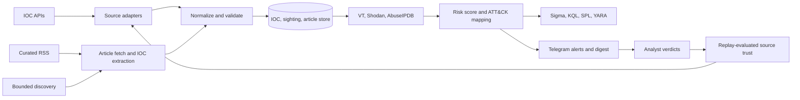
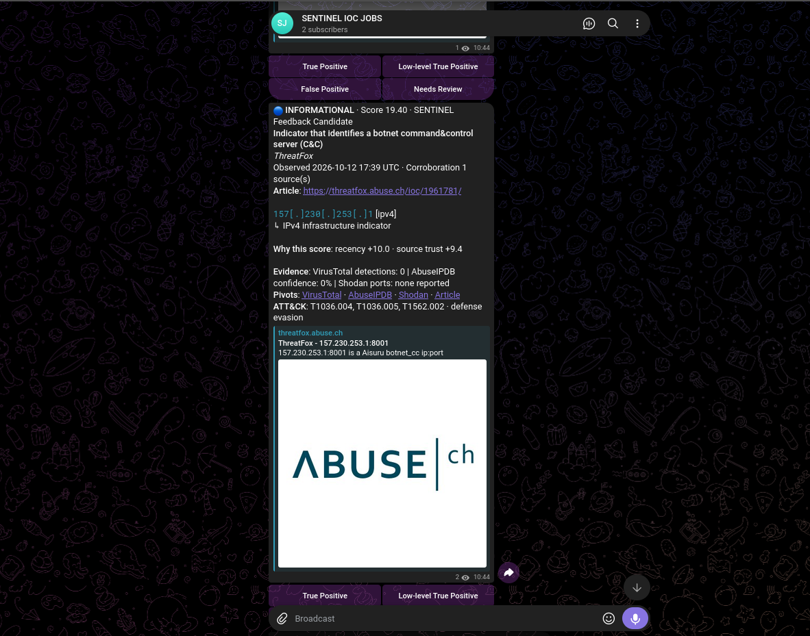
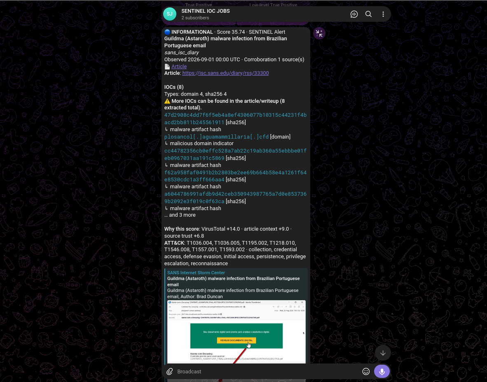
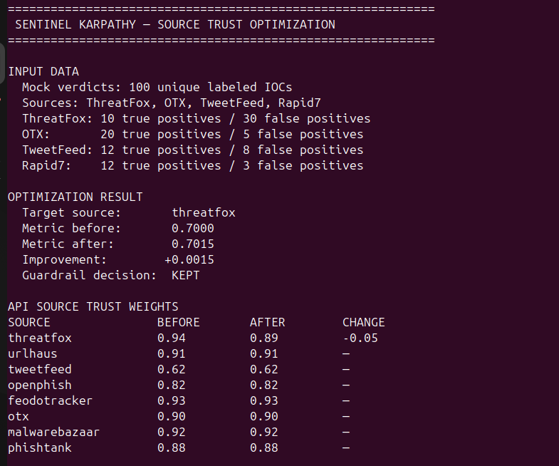

# SENTINEL

SENTINEL is a threat-intelligence pipeline for atomic IOC feeds and security research. It collects indicators, preserves source lineage, extracts IOCs from articles, enriches and scores them, maps behavior to MITRE ATT&CK, generates detections, and delivers analyst-ready Telegram alerts. Analyst verdicts drive a guarded replay loop for source trust.

## Architecture



Production uses two execution paths:

- `cron-run`: bounded collection, extraction, enrichment, scoring, detection generation, delivery, and retention.
- `feedback-service`: Telegram verdict collection and the scheduled source-trust learner.

Both paths share PostgreSQL or SQLite state. Redis is optional.

## Ingestion

Dedicated adapters handle ThreatFox, URLhaus, TweetFeed, OpenPhish, FeodoTracker, AlienVault OTX, MalwareBazaar, and PhishTank. Each adapter normalizes provider data and applies freshness rules before validation.

RSS entries are source material, never IOCs. SENTINEL fetches each selected article, converts HTML into line-oriented text, locates explicit IOC sections, and extracts domains, URLs, IPv4 addresses, hashes, and CVEs.

Precision controls include:

- SANS ISC suppresses public DNS resolvers and requires attacker, scanner, hash, or communication context.
- ReversingLabs accepts only entries tagged `Threat Research` before article fetch.
- Google Cloud Threat Intelligence requires an explicit IOC section.
- Article caps reserve space for each IOC type so hash blocks cannot hide later network indicators.
- Discovery profiles enforce freshness, host policies, candidate caps, and fetch budgets.

Check Point Research is wired but disabled because its WAF has returned HTTP 202 with an empty body to non-browser clients. ReversingLabs remains disabled pending scheduled-alert approval.

## Storage and lineage

| Table | Purpose |
|---|---|
| `iocs` | Canonical IOC, enrichment, score, severity, ATT&CK mapping, detection state |
| `ioc_sightings` | Source, provenance, reference, timestamps, and repeat count |
| `source_materials` | Article URL, title, publication time, fetched text, extraction status |
| `feedback_records` | Analyst verdict with source snapshot |
| `alert_events` | Delivery ledger, cooldowns, and digest deduplication |
| `experiment_logs` | Replay metrics, proposals, keep/revert decisions, skill hashes |
| `pipeline_runs` | Run status, counts, errors, and stage durations |

Canonical deduplication retains every sighting, so corroboration remains measurable across sources.

## Enrichment, scoring, and detections

Enrichment uses VirusTotal, Shodan, AbuseIPDB, and optional WHOIS. Provider timeouts, batch size, and per-run limits bound external work. Missing credentials disable only the related evidence component.

Risk scores combine recency, source trust, enrichment evidence, article context, corroboration, and validation state. The component breakdown is stored and rendered in Telegram.

MITRE ATT&CK matching uses a local Enterprise ATT&CK STIX bundle. Detection generation is IOC-type aware:

| IOC | Detection path |
|---|---|
| Domain | DNS-query Sigma, KQL, and SPL |
| URL | Proxy and web-request rules |
| IPv4 | Network-connection rules |
| Hash | Process/hash telemetry and YARA |

## Telegram output

Atomic alerts include a defanged IOC, source, score components, evidence, ATT&CK mapping, pivots, and feedback buttons.



Article alerts group indicators by writeup, report the type distribution, reserve visible samples for each available type, and link to the complete source.




Verdicts are True Positive, Low-level True Positive, False Positive, and Needs Review. `Remove IOC` deletes the IOC and linked lineage; use False Positive when the record should remain available for learning.

## Source-trust replay

The live learner changes only `Trust Scores` in `skills/sources/SKILL.md`. It requires recent labels from multiple sources, selects a source with positive and false-positive verdicts, sweeps a bounded ±0.05 range, replays the labeled window, and keeps a proposal only when metric and TP/FP guardrails pass.

Runs use isolated Git worktrees and DB-backed leases. Every attempt is recorded, including reverted proposals.



The image shows a controlled mock replay used to verify the mechanism. Production changes should use analyst verdicts.

## Quick start

Requirements: Python 3.12+, a database, and Enterprise ATT&CK STIX data.

```bash
git clone https://github.com/Nicholas-devsec/SENTINEL.git
cd SENTINEL
python3.12 -m venv .venv
.venv/bin/pip install -e .
cp .env.example .env
git clone https://github.com/mitre-attack/attack-stix-data.git data/attack-stix-data
```

Minimum environment:

```dotenv
DATABASE_URL=sqlite+aiosqlite:///./data/sentinel.db
REDIS_URL=disabled
TELEGRAM_BOT_TOKEN=...
TELEGRAM_CHAT_ID=...
MITRE_STIX_PATH=/absolute/path/to/data/attack-stix-data/enterprise-attack/enterprise-attack.json
OTX_API_KEY=...
THREATFOX_API_KEY=...
MALWAREBAZAAR_API_KEY=...
VT_API_KEY=...
SHODAN_API_KEY=...
ABUSEIPDB_API_KEY=...
OPENAI_API_KEY=...
```

```bash
env PYTHONPATH=. .venv/bin/pytest
env PYTHONPATH=. .venv/bin/python -m sentinel.cli scraper-diagnose
env PYTHONPATH=. .venv/bin/python -m sentinel.cli cron-run
```

## Production deployment

External cron uses the host timezone. `schedule.timezone` applies to the legacy in-process scheduler.

```cron
5 0 * * * cd /home/ubuntu/SENTINEL && env PYTHONPATH=. .venv/bin/python -m sentinel.cli cron-run >> logs/cron-run.log 2>&1
```

Run feedback collection separately:

```ini
[Unit]
Description=SENTINEL Telegram feedback and source-trust learner
After=network-online.target

[Service]
WorkingDirectory=/home/ubuntu/SENTINEL
Environment=PYTHONPATH=.
ExecStart=/home/ubuntu/SENTINEL/.venv/bin/python -m sentinel.cli feedback-service
Restart=always
RestartSec=10

[Install]
WantedBy=multi-user.target
```

## Operator commands

```bash
sentinel cron-run
sentinel daily-digest
sentinel scraper-diagnose
sentinel status
sentinel discover
sentinel discovery-memory --sync
sentinel feedback-service
sentinel karpathy-status --loop source
sentinel karpathy-validate --loop source --scenario improve
sentinel karpathy-run --loop source --max-experiments 1
```

Equivalent module form: `env PYTHONPATH=. .venv/bin/python -m sentinel.cli <command>`.

## Configuration controls

- `workflow.*_store_limit_per_run` bounds database intake.
- `workflow.telegram_*_alert_limit_per_run` bounds delivery.
- Source and writeup age limits reject stale data.
- `sources.mix.max_items_per_source` limits source dominance.
- Enrichment timeout, batch, and IOC caps bound API work.
- `retention.*` controls feed, article, alerted, and feedback-labeled TTLs.
- Karpathy delta, replay, TP/FP, and lease settings control promotion.

## Repository map

```text
sentinel/agents/       ingestion, extraction, validation, enrichment, scoring, delivery
sentinel/delivery/     Telegram and digest rendering
sentinel/loops/        replay evaluation and bounded optimization
sentinel/scheduler/    cron and learner scheduling
sentinel/db/           ORM models, sessions, and migrations
skills/                versioned source, discovery, scoring, and detection policy
docs/                  operational and learner documentation
tests/                 unit and integration tests
pictures/              README screenshots
config.yaml            sources, budgets, thresholds, and schedules
```

See [docs/karpathy_loop.md](docs/karpathy_loop.md) for learner mechanics and guardrails.
